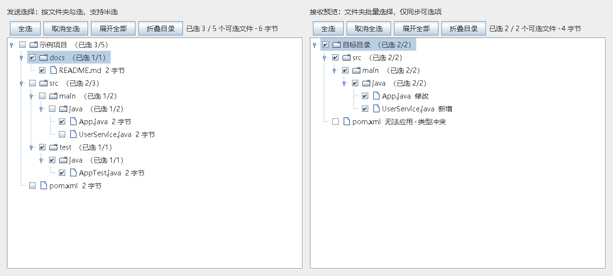

# Clipboard Directory Sync

通过**文本剪贴板**在本机和虚拟机的 IDEA 之间同步整个目录。**0.3.1 接收端仅显示有差异的文件**，支持目录树勾选文件夹，直接同步，不创建备份；保留 0.2 的自动收发，适用于 Windows 自带远程桌面（mstsc）的双向剪贴板重定向。两边安装同一个插件，运行时不需要另外开通网络端口、共享目录、Git 或外部程序。操作界面为中文。

兼容目标：IDEA **2025.1.2 和 2025.3.3**，以及声明范围内的 251–253 系列。两个指定版本的验证情况见 [验证记录](docs/verification.md)。

## 下载

从 [GitHub Releases 下载 0.3.1](https://github.com/keyboardman2022/idea-clipboard-sync/releases/tag/v0.3.1)：安装包、源码 ZIP 和远程端文字安装文件均放在该版本附件中。



## 安装

安装包：`build/distributions/idea-clipboard-sync-0.3.1.zip`。**接收端升级到 0.3.1** 后即可隐藏相同文件；建议两边均使用新版。使用原来的磁盘安装入口覆盖安装，按 IDEA 提示重启；旧版本留下的备份和接收缓存不会被自动删除。

两边 IDEA 均进入 **Settings → Plugins → 齿轮 → Install Plugin from Disk…**，选择 ZIP；IDEA 提示重启时按提示重启。插件列表里的名称为 **Clipboard Directory Sync**。

### 虚拟机只能粘贴文字时，如何传入初次安装包

打包后会生成 `build/distributions/clipboard-install-0.3.1/`：

- `vm-install-all.txt`：复制全文，粘贴到虚拟机的 PowerShell 并执行，即可还原经过 SHA-256 校验的 ZIP。脚本末尾会输出安装包路径；再通过 IDEA 的 Install Plugin from Disk 安装。
- 如果长文本被截断，改为逐个复制 `part-001.txt`、`part-002.txt` 等到虚拟机 PowerShell 执行，最后执行 `finish.txt`。每段可重复执行；缺段或校验不符会报错，不能生成安装包。分段文件可以乱序执行，但 `finish.txt` 必须在全部段写入后执行。

这些文字脚本用于 **Windows 虚拟机的首次安装**。插件本身使用跨平台 Java API；其他系统可以通过已有的离线安装通道传入 ZIP。不要在 IDEA 编辑器里粘贴并运行这些安装脚本。

## 自动同步一个目录（推荐，适合数百段）

1. **发送端**右键源目录 → **剪贴板同步 → 发送目录…**，在目录树中勾选文件夹或单个文件，点击 **生成同步数据并复制第一段**，等待生成完成。
2. **接收端**右键目标目录 → **剪贴板同步 → 接收数据到此目录…**，点击一次 **自动接收**。
3. 回到**发送端**，点击一次 **自动发送全部**。接下来无需来回切换窗口或逐段点击。
4. 全部收齐并通过整包校验后，接收端自动显示目录树。按文件夹选择要应用的内容，查看差异，再点击 **应用选中文件**。

### 目录树选择

- 保留源目录的层级结构，默认勾选全部可同步文件。勾选或取消一个文件夹，会作用于其所有层级的子文件。
- 取消部分子文件后，父目录显示部分选择状态及已选数量；再次勾选父目录可选中全部可选子文件。
- 支持 **全选、取消全选、展开全部、折叠目录**。只同步某个文件夹时，可先取消全选，再勾选该文件夹。
- 键盘方向键浏览和展开目录，**空格**切换当前文件或文件夹的勾选状态。
- 接收端只展示“新增、修改、无法应用”的文件；内容相同的文件直接隐藏，仅包含相同文件的子目录也隐藏。冲突文件仍显示原因，复选框不可勾选。
- 本次接收文件全部相同时，提示“接收的文件均相同，无需同步”，并禁用应用按钮。目标端独有文件仍保留。
- 选择具体文件后点击 **查看选中文件差异**；目录选择仍按相对路径映射，不会额外嵌套一层目录。
- 生成数据与应用文件期间暂时锁定勾选，确保界面选择和实际操作一致。源数据生成后保持该次快照的选择不变。

两端需要保持 IDEA、收发窗口和 RDP 连接运行。沿用当前已经能双向复制文字的远程桌面连接即可；不要在传输期间关闭或断开会话。自动收齐不会自动覆盖代码。

自动模式先握手，避免误认剪贴板里残留的旧传输；每段保存并校验后才回复确认，再发送下一段。默认每 150 毫秒检查一次，3 秒未确认重发，每段最多 10 次发送尝试；长时间没有回应会暂停并提示原因。

- **暂停／继续**：暂停立即停止新的自动写入。网络恢复后在两端点击各自需要继续的按钮；仍保留当前分段进度。
- **停止后重启**：先停止两边的自动模式，再重新点击接收端“自动接收”和发送端“自动发送全部”。同一发送窗口的数据会复用已有分段；若整个包之前已收齐并验证，接收端可以直接回复完成。
- **复制了其他内容**：活动传输检测到普通剪贴板内容时会暂停，避免继续覆盖你的新复制内容；请先完成其他复制任务，再点击继续。刚启动、尚未连接时的旧剪贴板内容不会被当作同步数据。
- **关闭发送窗口**：当前待发送数据释放，需重新选择目录并生成一份新包。接收端旧缓存仍保留，可手动清理。
- **仅传输数据**：自动接收完成后仍需你确认应用文件；保留差异预览、未保存编辑和预览后修改检查，不生成备份。

每个 IDEA 进程只允许一个自动收发窗口运行，防止多个项目争用同一系统剪贴板。接收完成后会短暂继续响应末段重发，最终预览会等待其他后台任务结束后显示。

自动模式的协议与重试已通过模拟测试；真实 mstsc 剪贴板链路仍需在你的连接上验证。RDP 剪贴板重定向说明见 [Microsoft 协议文档](https://learn.microsoft.com/en-us/openspecs/windows_protocols/ms-rdpeclip/30688d09-96b6-46f8-af18-ea1998bb7987)。

## 手动同步一个目录（保留）

1. **发送端**：在 IDEA 项目树中右键源目录 → **剪贴板同步 → 发送目录…**。
2. 在目录树中勾选要同步的文件夹或文件，点击 **生成同步数据并复制第一段**。
3. **接收端**：右键对应的目标目录 → **剪贴板同步 → 接收数据到此目录…** → **读取剪贴板并接收**。
4. 收齐后在目录树中选择需要更新的文件夹或文件，必要时点击 **查看选中文件差异**，再点击 **应用选中文件**。

两边互换角色就可以反向同步。也可以从 IDEA 的 **Tools → 剪贴板同步** 进入并选择目录。

例如，源目录 `D:\work\project\src` 对应目标目录 `/home/user/project/src`，其中 `main/java/App.java` 写入目标目录下的 `main/java/App.java`，不会额外嵌套 `src`。

| 目标情况 | 插件行为 |
| --- | --- |
| 已有相同文件 | 从接收目录树隐藏，跳过写入 |
| 已有不同文件 | 列为“修改”，可比较后勾选应用 |
| 不存在的文件 | 列为“新增”，自动创建文件与父目录 |
| 仅接收端存在的文件 | 保留，不执行删除 |
| 文件/目录同名或大小写冲突 | 列为“无法应用”，不会自动替换 |
| 预览后文件又被修改，或有未保存编辑 | 拒绝该项写入，提示重新预览或先处理编辑 |

发送的是所选文件的完整快照，接收端比较后仅写入新增或不同的文件。双方修改的内容由用户在差异界面判断；没有自动合并或自动判断哪边更新。

## 手动多段传输与续传

发送界面显示 **第 N / 总数 段**。第一段发送后，在发送端点击 **下一段并复制**，切换接收端点击 **读取剪贴板并接收**，直到全部收齐。可以重发任意一段，也支持乱序接收。

接收界面显示已收数量与缺失段号。关闭或重启 IDEA 后，已接收片段仍保留；在会话列表选中原会话，点击 **重新预览 / 继续会话**。**发送端窗口关闭后需重新生成新的传输**，不能把新包的分段混入原会话。

普通代码和其他剪贴板文字不会被识别为同步包。手动模式下必须点击复制与接收；自动模式则由你显式启动后持续收发。分段或整包校验失败时不会应用文件。

## 设置、限制与跳过项

**剪贴板同步 → 同步设置…** 可以调整每段字符数与附加忽略规则。默认每段约 64 KiB；如果虚拟机剪贴板会截断长文本，可以减小为 16 KiB 或 4 KiB。

- 默认忽略 `.git`、`.idea`、`target`、`build`、`node_modules`、`.clipboard-sync`、`.vmsync` 目录；不会跟随符号链接，也不单独传输空目录。
- 附加规则每行一条：`*.log` 匹配任意目录下的日志文件；`temp/**` 忽略源目录下的 temp 子树；`*` 不跨 `/`，`**` 可跨层级；文件名匹配区分大小写。
- 点击发送窗口里的 **查看跳过项** 可以检查排除原因。
- 默认单文件最多 10 MiB、全部原始内容最多 100 MiB、最多 10,000 个文件、最多 4,096 段。
- **扫描阶段超限时会直接停止**。此时需先在设置中排除大文件/生成目录，或改为选择更小的子目录，再重新发送；尚不能在超限后的文件清单中取消勾选。
- 最多保留 10 个接收会话、共 300 MiB 接收片段；通过接收窗口的 **清理选中会话** 释放缓存。该操作不修改代码文件。

文件内容按原始字节传输，保留编码、换行和二进制内容。差异预览支持 UTF-8 文本；其他编码或二进制文件显示摘要，仍可按原始字节同步。现有目标文件的 POSIX 权限在替换时保留；新文件使用接收端文件系统的默认权限，不同步源端的可执行标记。

## 直接同步与接收缓存

0.3.0 直接新增或更新选中的文件，不创建 `.clipboard-sync/backups/`，也不再提供恢复备份菜单。旧版本留下的备份保留原样，不参与新版同步。

分段缓存仍位于**当前 IDEA 项目根目录**下 `.clipboard-sync/receive/`，用于断点接收和重发校验。它是传输数据，不是被覆盖文件的历史备份；可通过接收窗口“清理选中会话”删除。建议在业务项目的版本控制忽略规则中加入 `.clipboard-sync/`。

写入时仍使用短暂的临时文件替换目标，完成后清理临时文件，不保留副本。整个目录不是一次原子替换；中途失败或取消时会列出成功、失败和未处理的项，可以重新预览后继续同步。目标独有文件仍然保留，不传播删除。

## 构建

标准构建需要 Java 21、Gradle Wrapper，以及可访问构建依赖的网络：

```powershell
./gradlew.bat test buildPlugin verifyPlugin
```

工程以 IDEA 2025.1.2 API 为默认目标；`-PlocalIdePath="D:\IntelliJ IDEA 2025.3.3"` 可以显式改用本机 SDK 诊断编译。

附加的本地构建路径可避开本环境 Gradle 的网络问题：

```powershell
python tools/bootstrap.py
python tools/fetch-sdk-api.py
./tools/test-local.ps1 -JavaHome "C:\path\to\jdk-21"
./tools/build-local.ps1 -JavaHome "C:\path\to\jdk-21"
python tools/make-clipboard-installer.py
```

`fetch-sdk-api.py` 从官方 2025.1.2 安装 ZIP 按范围提取编译所需 JAR，不下载整个 IDE；编译与打包不包含这些 SDK 文件。`build-local.ps1 -IdeHome <IDE路径>` 可使用另一个安装目录。测试和打包脚本不会修改全局 Java 设置。

真实虚拟机的剪贴板桥接、首次离线安装与双端界面操作，还需要在实际虚拟机环境验证。
